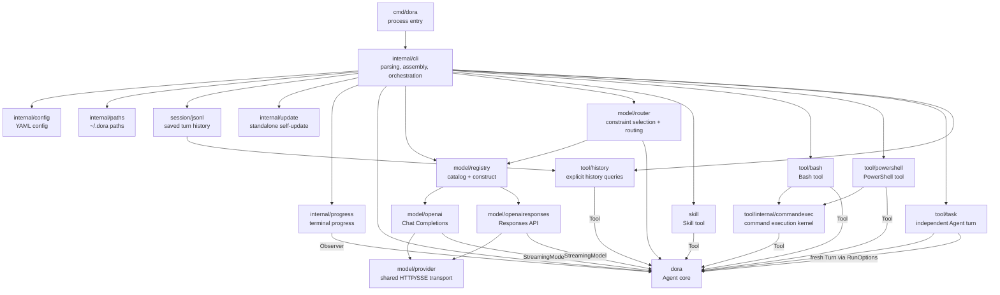
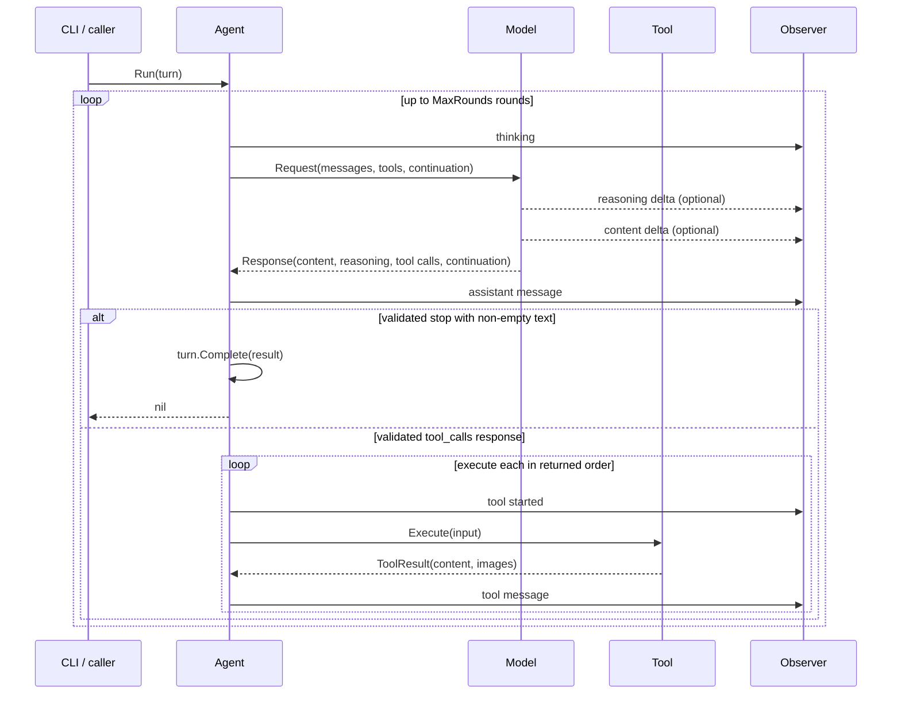

# Dora Architecture

This document describes the module boundaries, dependencies, primary interfaces, and runtime flow of the current Dora implementation. It records the current state, not future plans; when code behavior changes, this document should be updated accordingly.

## Design Goals

Dora is a small, composable LLM agent. The core design principles are:

- The core loop depends only on a small set of interfaces, not on any concrete model, tool, CLI, or storage implementation.
- Each package has a single primary responsibility; cross-package access happens through explicit interfaces or data structures.
- The CLI is the composition root, responsible for selecting and assembling implementations; the core packages do not read configuration or environment variables.
- One mutable `Turn` is explicitly passed to the Agent; `Agent` holds immutable model, tool, safeguard, and system-prompt configuration and no mutable state across tasks.
- All external operations accept `context.Context`, supporting cancellation and timeouts.

## Overall Structure



Key constraints on dependency direction:

- The root package `dora` does not import any concrete implementation package within the project. `dora.Capability` and `dora.Constraints` are root value types shared by `model/registry` and `model/router` without an import cycle.
- Model adapters and tool packages depend on the interfaces and data structures in `dora`.
- `internal/*` serves only the Dora application and cannot be imported directly from outside the module.
- `internal/cli` knows all concrete implementations and is the composition root; model assembly is delegated to `model/router` (selection) and `model/registry` (construction).

## Directories and Modules

| Module | Responsibility | Primary interface or entry point |
| --- | --- | --- |
| `dora` | Domain abstractions for the agent loop, messages, models, tools, and observers | `New`, `NewWithConfig`, `Agent.Run*`, `Model`, `Tool`, `Observer` |
| `cmd/dora` | Process startup, signal handling, terminal capability detection, final error output | `main` |
| `internal/cli` | Argument parsing, dependency assembly, terminal presentation, and frontend selection | `Run(context.Context, []string, IO)` |
| `internal/app` | Frontend-neutral prompt lifecycle, cancellation, terminal-state persistence, and per-session job ownership | `NewSession`, `Session.Prompt`, `Session.Cancel`, `Session.Close`, `Session.Shutdown` |
| `internal/config` | Strict reading, parsing, and validation of YAML configuration | `Load(string)` |
| `internal/imagefile` | Validates local image files and encodes them as data URLs | `Validate`, `DataURL` |
| `internal/paths` | Resolves Dora's default configuration and skill paths | `ConfigFile`, `SkillsDir` |
| `session` | Defines saved-turn history contracts and query records | `Reader`, `Store` |
| `session/jsonl` | Saves turns to a user-selected JSON Lines file as they run (`running`) and finalizes them as completed, maximum-round, failed, or canceled | `Open`, `Store.BeginTurn` (`TurnWriter.Sync`, `TurnWriter.Finish`), `Store.CommitChild`, `Store.ListTurns`, `Store.GetRounds` |
| `internal/update` | Queries stable Releases, validates archives, and replaces the standalone binary with rollback | `New`, `Service.Update` |
| `internal/progress` | Renders semantic run events as terminal output | `New`, `Renderer.Observe` |
| `model/provider` | Shared HTTP transport, retry, SSE, and error infrastructure for model adapters | `New`, `Provider.PostStream` |
| `model/openai` | OpenAI-compatible Chat Completions SSE protocol adapter | `New`, `Client.GenerateStream` |
| `model/openairesponses` | Responses API, SSE stream, and provider continuation adapter | `New`, `Client.GenerateStream` |
| `model/registry` | Catalog registration/query (order = priority) and per-protocol adapter construction | `NewCatalog`, `Catalog.Providers`, `Construct` |
| `model/router` | Constraint-based selection, `dora.Model` routing with caching; internal `selection` | `New`, `Router.Generate`, `Router.GenerateStream`, `Router.View`, `Router.SetThinking`, `Router.TextSelection` |
| `skill` | Discovers and validates local `SKILL.md`, returns full instructions to the model on demand | `New`, returns `dora.Tool` |
| `tool/bash` | Executes Bash within the current directory with background transition and output-limit constraints | `New`, `Tool.Spec`, `Tool.Execute` |
| `tool/powershell` | Executes PowerShell using `pwsh` or `powershell.exe` | `New`, `Tool.Spec`, `Tool.Execute` |
| `tool/history` | Gives the model paginated access to saved turns and rounds | `New`, `Tool.Spec`, `Tool.Execute` |
| `tool/viewimage` | Loads a local image file or remote URL and returns a text description via a transient visual model | `New`, `Tool.SetViewer`, `Tool.Spec`, `Tool.Execute` |
| `tool/task` | Runs an instruction through the same Agent in a fresh Turn, excluding itself from the nested run | `New`, `Tool.Spec`, `Tool.Execute` |
| `tool/internal/commandexec` | Implements input validation, process execution, background transition via wait_seconds, and structured results for command tools | `New`, `Tool.Spec`, `Tool.Execute` |

## Core Interfaces

### Model

```go
type Model interface {
    Generate(context.Context, Request) (Response, error)
}

type StreamingModel interface {
    Model
    GenerateStream(context.Context, Request, func(ModelEvent)) (Response, error)
}

type ContextSize interface {
    ContextSize() int
}
```

`Model` is the minimal interface that every model implementation must satisfy. `StreamingModel`, `ContextSize`, and `OutputSize` are optional capabilities: when the Agent detects `StreamingModel` it uses the streaming method, otherwise it falls back to `Generate`; when it detects `ContextSize` and the reported value is positive it uses it as the context token budget for compaction, otherwise it falls back to `DefaultContextWindowTokens`; when it detects a positive `OutputSize.MaxOutputTokens`, it treats that value as the model's hard output capacity. These capabilities leave the `Model` and `StreamingModel` contracts unchanged.

`Request` contains the complete provider-neutral messages, available tool definitions, and an opaque `Continuation`. `Response` can contain both text and multiple tool calls. It requires an explicit
`FinishReason` (`stop`, `tool_calls`, `output_limit`, `blocked`, or `unknown`),
and carries `RawFinishReason` and the effective `OutputBudget`. Zero budget means
unknown. Custom Model implementations must adopt this contract; empty/unknown
reasons are not inferred from response content.

`Response` also carries an optional `Usage *Usage` payload describing the tokens a single model call consumed (input, output, and total, plus optional `InputTokenDetails`/`OutputTokenDetails` breakdowns). Input details include cached and audio tokens; output details include reasoning, audio, and accepted/rejected prediction tokens. It is provider-neutral, populated by the adapters, and is `nil` when a provider reports no usage or is not asked for it. Usage is carried by the `UpdateMessageReceived` observer event on every complete round, retained on the corresponding `Round` or final `Turn`, persisted by session storage, and used by the compactor as the previous round's `total_tokens` occupancy baseline (falling back to a token estimate when usage is nil). The renderer does not display it. For one-shot CLI runs, `--trace-file` writes the provider-neutral parent Turn—messages, reasoning, tool calls/results, images, and per-call usage—so integrations can translate it to external trajectory formats and aggregate usage without coupling the kernel to them.

`dora` provides `InputTokens`/`TotalTokens` as pure-function exits for accounting context usage from a `dora.Usage` (provider-neutral and nil safe); normalization conversion from provider wire formats remains in the adapters' private helpers.

### Tool

```go
type Tool interface {
    Spec() ToolSpec
    Execute(context.Context, json.RawMessage) (ToolResult, error)
}

type ToolResult struct {
    Content string
}
```

`Spec` exposes the name, description, and JSON Schema to the model. `Execute` receives only the model-generated JSON arguments and returns content for the resulting tool message. The core Agent does not know the concrete type of a tool and does not parse tool-specific output conventions or access image files.

A tool may also implement the optional `ExclusiveTool` interface (`Exclusive() bool`) to say that its calls change state which other calls of the same model response can observe or depend on, such as files or processes. The built-in `write`, `edit`, `bash` and `powershell` tools are exclusive; read-only and independent tools (`read`, `grep`, `glob`, `history`, `job`, `task`, `skill`, `view_image`, the event tools) are not. See the Agent loop for how exclusive calls are scheduled.

Within the same Agent, tool names must be non-empty and unique. Tool definitions are copied when the Agent is constructed, preventing the caller from later modifying their JSON Schemas.

`RunObservedWithOptions` accepts per-run `RunOptions`. Its `ExcludeTools`
names are removed from both the definitions sent to the model and the lookup
map used for execution. `WorkingDirectory` is carried through the run context
and is available to tools through `dora.WorkingDirectory`; the Agent does not
change process state or interpret the path. Built-in filesystem, image, and
command tools use it as the base for relative paths. `Run` and `RunObserved`
retain their original APIs and delegate with empty options. Options are local
to a run and never mutate the Agent, so independent Turns may use different
tool sets and working directories concurrently.

`RunOptions.OnRound` is an optional synchronous callback invoked on the Agent's
goroutine after each complete tool round is appended to the Turn and before the
next model request. It lets a caller persist progress incrementally; it is not
called for the final response, which completes the Turn. The callback may read
the Turn but must not mutate it. The core Agent knows nothing about storage:
`internal/app` wires this hook to a `session.TurnWriter`.

### Observer

```go
type Observer interface {
    Observe(Update)
}
```

The Observer synchronously receives semantic events such as `thinking`, reasoning deltas, content deltas, assistant message received (`message_received`), tool started, and tool finished (`tool_finished`, carrying the tool's success result or its error). The former `message_added`, `tool_failed`, and `usage` events have been removed. It only consumes run data, does not participate in Agent decisions, and cannot modify the session history.

After the Agent obtains a complete response for a round (tool or final) it emits an `UpdateMessageReceived` event carrying that round's assistant message and the optional `Response.Usage` (`nil` when the provider reports none; usage is carried but never rendered). Each tool call then emits an `UpdateToolFinished` after its `UpdateToolStarted`: on success it carries the tool result message, and on failure it carries a non-nil `Err`. The `internal/progress.Renderer` displays the assistant message, renders each tool line (splitting success/process-level failure by `Err`, and letting content-level signals such as bash exit codes drive warning/failure styling), and does not print usage; `--quiet` silences the renderer entirely.

Callbacks run on the Agent's current goroutine, so implementations should return quickly. `internal/progress.Renderer` is the Observer used by the CLI.

### Turn and Round

```go
type Round struct {
    Assistant Message
    Tools     []Message
    Usage     *Usage
}

agent, err := dora.NewWithConfig(model, dora.AgentConfig{
    SystemPrompt: systemPrompt,
}, tools...)
turn := dora.NewTurn(userInput)
err := agent.Run(ctx, turn)
result, complete := turn.Result()
```

`Turn` is the Agent's mutable run state. It is constructed from one user input.
On its first run, the Agent binds a snapshot of its immutable system prompt to
the Turn; an empty prompt omits the system message. The Turn then appends only
complete rounds and ends with a final assistant result without tool calls. A
round contains one assistant message with one or more tool calls, all
corresponding tool messages in call order, and the optional usage reported for
that model call. The Turn separately retains the final response usage, exposed
through `Turn.Usage`. Provider continuation is opaque and exists only in the
live Turn; it is not persisted. All exported accessors return defensive copies.

## Agent Loop



Current execution semantics:

- The Agent is immutable and owns the system prompt; mutable messages, the bound system-prompt snapshot, and continuation belong to the supplied Turn.
- A run may exclude tools without mutating the Agent; excluded tools are neither advertised nor executable for that run.
- Input messages, tool calls, and output state are all defensively copied.
- Tool packages translate tool-specific output conventions into `ToolResult`; the Agent only forwards its content and images into the provider-neutral message history.
- When the model returns multiple tool calls, they are planned into batches in the returned order. Consecutive calls to ordinary tools form one batch and run concurrently. A call to an `ExclusiveTool` is a batch of its own: it starts only after every earlier call has finished and no later call starts until it has finished. So independent reads overlap, while a `write` followed by a `bash` that runs the file, or two `edit`s that depend on each other, run in the order the model wrote them. Within a batch, `UpdateToolStarted` events are emitted in call order and `UpdateToolFinished` events as results arrive; a call is reported started when it really begins, so a later batch's started events follow the earlier batch's finished events. Tool messages are always stored in the returned order. A panic or an error in one call (including an unknown tool or invalid arguments) never blocks the batches after it. Ordinary tools must be safe for concurrent use; the built-in command and skill tools are. Commands from one response therefore no longer overlap; a long-running command should use `wait_seconds` to move to the background.
- Content from both APIs can be displayed as it is received, but tools must wait until the entire model response has finished before execution begins.
- Both model adapters classify incomplete stream JSON (`unexpected end of JSON input`) as retryable; other JSON syntax and type errors remain non-retryable. Retryable model failures restart the current request even after content or reasoning deltas have been emitted. Generic failures allow six total attempts, with base delays of 2, 4, 8, 16, and 30 seconds plus up to 50% jitter. Rate-limit failures retain five total attempts and their existing delay policy; a positive provider retry delay overrides local backoff, but only up to two minutes: a longer `Retry-After` (an exhausted quota, an hour-long wait) fails the request at once with an error stating the requested wait, instead of silently stalling the run. `ParseRetryAfter` clamps absurd values to one year so the duration cannot overflow. Normal request retries emit `UpdateInfo` with the next attempt, wait, and error; internal compaction requests have no observer. Cancellation stops retries and interrupts waits. Only a complete successful response is committed or allowed to execute tools, so prior completed tool rounds are not replayed. Already emitted presentation deltas cannot be retracted and may be repeated after recovery.
- Output-limited responses are retained only in `Turn.Attempts`, never in conversation history. `AgentConfig.OutputLimitRecovery == nil` enables one additional request with twice the effective output budget, clamped to configured/model capacity and remaining context. An explicit zero-retry policy disables recovery. Unknown budgets, no room to increase, exhausted retries, empty final text, blocked output, or unknown finish reasons return identifiable errors. Retry history and continuation remain at the last complete exchange. Cancellation also stops recovery. The adapter maps Chat `length` and Responses `incomplete/max_output_tokens` to `output_limit`; `[DONE]` alone is not a successful semantic finish.
- A tool execution error, an unknown tool, invalid JSON tool arguments, or a panic inside a tool (recovered and reported as `tool "name" panicked: ...`) does not terminate the task: the Agent feeds the failure back to the model as a `tool` message so the model can correct itself, and continues the loop. A tool itself may choose to encode a command failure as a normal result. For example, Bash returns a non-zero exit code to the model rather than terminating the Agent directly.
- If the model keeps calling tools, reaching `MaxRounds` returns `ErrMaxRounds`; the completed rounds remain in the same Turn. The CLI may call the Agent again with that Turn after interactive confirmation. Continuing does not persist an intermediate record. Declining or a non-interactive failure persists the Turn with status `max_rounds` when a session is configured; non-interactive runs still report the error directly.
- The CLI constructs the Agent with the configured `agent.system_prompt` (which fully replaces the built-in default) or, when unset, the default embedded at `internal/cli/prompts/default_system.md`. The CLI appends a `runtime_environment` block with `runtime.GOOS`, `runtime.GOARCH`, and the local Agent start date (`YYYY-MM-DD`, without time) to either prompt. It captures the date at CLI startup and keeps it fixed for the Agent lifetime, including child tasks; it does not refresh across midnight. Environment collection remains outside the kernel. Each Turn receives a snapshot from that Agent when it starts. Session-history behavior is described by the history tool itself rather than duplicated in the system prompt.
- Before each normal model request, the Agent predicts context occupancy and leaves the history untouched until the prediction, including an output reserve, reaches 80% of the model-reported `contextWindow`. The estimate anchors on the previous normal call's real `total_tokens`, which already includes that request's tool schema and assistant response, then adds only tool results produced afterwards. Without reported usage it estimates the complete model-visible history and tool schemas using about four ASCII bytes or one non-ASCII rune per token plus a small framing allowance; vision tokens remain provider-specific and unestimated. At the threshold, the Agent calls the active model with the complete model-visible history plus a summary instruction, but with no tools and no opaque continuation. The replacement summary must be non-empty, contain no tool calls, and fit within 20% of the context window, capped further by the model's optional hard output capacity. The effective target is attached to the summary `Request` as `MaxOutputTokens`, overriding the model profile's ordinary per-response `max_tokens`; adapters defensively clamp it to the hard capacity again. An oversized, empty or output-limited (cut off) summary gets one stricter retry that asks for half the budget while the hard output cap stays unchanged, because a too-long summary normally shows up as being cut off at the cap; any other invalid response is rejected at once. The summary request is also sized against the context window: the calibrated input estimate, a prompt allowance and a 5% margin are subtracted from the window, and when the target does not fit, tool results larger than a cap are shortened (head and tail with a marker; 32, 16, 8, 4, 2 then 1 KiB, stopping at the first cap that makes room) in a copy used only for that request, and the output budget is lowered to the room that remains but not below the lesser of the target and 1024 tokens. The request is never refused locally on these heuristics; the provider decides with exact counts. The history itself is never modified, and the compaction notice says how many tool results were shortened for the request. Only a validated summary atomically replaces the model-visible history. The result is the leading system messages, one user message holding the original task verbatim followed by the summary, and then the most recent rounds verbatim. The task is capped at 5% of the window (head and tail around a marker; the summarizer still sees all of it) and is taken from the `Turn`, not from the first message of the current model-visible history, so repeated compactions never nest an earlier summary message; task images are carried over. The verbatim tail is built from whole rounds, newest first, while they fit 10% of the window: an assistant message is never separated from its tool results, the oldest round is never part of the tail so something always remains to summarize, and a newest round larger than the budget is summarized instead of kept. The summary request contains everything before the tail, and the tail's estimate is subtracted from the request's input estimate. **Context overflow recovery.** `provider.APIError` classifies a 400, 413 or 422 whose error code/type or message carries a known context-window phrase (`context_length_exceeded`, "maximum context length", "prompt is too long", ...) as `dora.ContextLengthError`, which matches `dora.ErrContextLength` through `errors.Is` and is not retryable as-is; the Responses client classifies `response.failed` and `error` stream events the same way (`provider.StreamError`). Rate limits and server errors are never classified, even when their text mentions tokens. When a normal request fails with `ErrContextLength` in a round that was not just compacted, the Agent runs a forced compaction (no trigger check; the history is assumed to fill the window, so the tool-result shortening ladder applies to the summary request), clears the continuation, emits an `UpdateInfo` notice, and retries the request exactly once. If the summary request itself is rejected as too large it is re-planned once with a pessimistic input estimate (50% higher, at least the window) without consuming a summary attempt. A failed forced compaction reports both the provider error and the compaction error; a second overflow, or an overflow right after a proactive compaction, ends the run with the provider's error.

The capacity check returns a `CompactionResult` containing the selected history, whether compaction succeeded, predicted token counts before and after the attempt, summary tokens, context/trigger/target token limits, the number of summary attempts, the number of messages kept verbatim, and whether the task was shortened. Failure aborts the run without deleting or locally truncating messages, while preserving the available attempt statistics for diagnostics. The complete `Turn` remains unabridged for persistence. Because provider continuation state belongs to the replaced message history, successful compaction clears it before the next normal request; subsequent rounds continue from the new continuation returned for the summarized history. Successful compaction emits one `UpdateInfo` notification with the before/after predicted token counts, without exposing summary streaming deltas.

## CLI Run Flow

`internal/cli.Run` is the composition root and drives the terminal frontend:

1. Parse arguments; `--version`, `-update`, and `--setup` complete and exit before reading runtime configuration or the prompt. Setup updates only the selected YAML file's `env` and `policy.text`, validates the complete result, and preserves other fields and comments.
2. Resolve and load the default or explicit configuration and validate one-shot model/thinking/round overrides.
3. Normal CLI mode requires the model router immediately.
4. For a normal Agent run, validate `--workdir` and compose the user prompt from command arguments and standard input.
5. Open the active session: the file selected by `--session`, or an in-memory store when the option is omitted. Register a history tool backed by its Reader interface from the first turn; never load old turns into the model request.
6. Report the resolved conversation provider/profile and thinking configuration on stderr unless `--quiet` is active. An unset thinking configuration is displayed as `default`.
7. Discover skills and create the other available tools according to configuration.
8. Add the default-enabled task tool, construct an immutable `dora.Agent`, and wrap it with its Store, JobManager, and working directory in `internal/app.Session`.
9. `app.Session.Prompt` runs and persists the fresh Turn. The CLI supplies a continuation callback only for an interactive `ErrMaxRounds` prompt. Each complete tool round is saved as soon as it finishes, through `RunOptions.OnRound` and a `session.TurnWriter`, with the turn row in status `running`; a failed progress save only emits one `UpdateInfo` warning and the run continues, because the writer re-saves anything missing later. At the end the same row is finalized: `completed`; maximum rounds `max_rounds`; context cancellation `canceled`; other errors `failed`. The terminal save runs on a detached five-second commit context, so a cancellation racing the run-to-store transition cannot discard a terminal turn. A failing terminal save is tried up to three times (the writer is safe to retry; the wait starts at 200 ms and doubles) to ride out brief contention on the session file; if it still fails, the prompt returns a `PersistenceError`. A completed turn is never lost with it: the returned `PromptResult` still carries `Completed` and `Content`, and the CLI writes the answer to stdout before exiting with the error, so a one-shot `dora -p` run keeps its answer even though the turn is not in the history. The rounds saved earlier remain in the store with status `running`. When requested, the CLI then writes the parent `--trace-file`, including completed calls retained by a failed turn.
10. The terminal frontend writes completed text to stdout.

The process entry point converts both `SIGINT` and `SIGTERM` into context
cancellation, allowing the application to save a canceled Turn before exiting.
Callers such as GNU `timeout` must allow time for the Agent to return and the
detached five-second commit before escalating to `SIGKILL`; forced termination
cannot run this cleanup. Because every complete round is already saved while the turn runs, a forced exit (`SIGKILL`, a crash, or an out-of-memory kill) keeps the rounds finished so far; only the round in flight and the final status are lost, and the turn stays `running`.

The CLI's standard output carries only the final result; run progress and errors are written to standard error. TTY output is consistent with piped and redirected output, so results can still be safely used in scripts. Progress color defaults to automatic terminal and environment detection; `--color=always|never` overrides it without changing the renderer's terminal-only in-place updates. The transient `Thinking...` placeholder and its live repaint are omitted when stderr is not a terminal, while substantive progress lines remain append-only. Reasoning deltas reach the Observer on every run (capture, persistence, and provider resend do not depend on display), but the renderer streams them only when `--reasoning` is passed, one complete line at a time with a size cap for newline-free lines: terminal writes run on the Agent's goroutine, and per-token writes slow the model stream on slow terminals.

`cli.IO` injects the standard streams, build version, terminal capabilities, HTTP client, and test updater, allowing the CLI to be tested without depending on process-global state.

The setup flow selects a built-in provider and optional profile. It reads the
API key without terminal echo, writes the configuration through a validated
temporary file, and installs it with owner-only permissions on Unix. Existing
environment variables keep their normal precedence over config-local values.

## Model Adapters

### Finish reasons and attempt records

Every Agent model invocation, including compaction and transport retries, gets
an audit entry independent of completed tool rounds. `ModelAttempt` stores
round index, purpose, output-recovery index, disposition, finish metadata,
request budget, content, reasoning, tool arguments as strings (including invalid
JSON), usage, and transport errors when present. Failed transport calls may
have unavailable output/usage; unreported usage is not a measured zero.
`Turn.TotalUsage` sums reported attempts once. `Turn.Usage` remains final-call
usage, and `Turn.FinalResponse` retains the successful final reasoning/metadata.
Child task/image calls are not expanded in the parent attempt stream.

Trace schema 2 adds status/error, attempts, total usage, and final finish metadata
and reasoning. Harbor consumes attempts for accounting and only attaches actual
tool observations to accepted tool attempts; rejected tool calls remain audit
metadata. Schema 1 traces are rejected. The session store persists attempts in
`model_attempts`, exposes paginated `GetAttempts` through `session.AttemptReader`,
and stores total usage separately from final-call usage on `turns`.

### Chat Completions

`model/openai` converts Dora messages and tool structures into `/chat/completions` requests. It always requests an SSE stream, aggregates text and chunked tool arguments into a complete response, and implements `StreamingModel`. Its optional continuation carries structured reasoning details for tool-calling assistant messages when the selected profile enables reasoning preservation.

Reasoning models expose their chain-of-thought in non-standard delta fields. The adapter decodes `reasoning_content`, `reasoning`, and `reason` (first non-empty wins per event), plus visible text or summaries from `reasoning_details`, aggregates them into `Response.Reasoning`, and streams them before content deltas. Whether captured reasoning is resent on tool-calling assistant history messages is controlled by the profile-level `preserve_thinking` switch (default off). Plain reasoning is resent as `reasoning_content`; ordered `reasoning_details` chunks are stored unmodified in the opaque continuation and replayed on their original assistant message. DeepSeek and OpenRouter's built-in profiles enable preservation; providers that expect reasoning stripped keep it off. The final tool-free assistant message is never resent within a turn.

To capture token usage, Chat Completions requests always set `stream_options.include_usage: true`; compliant providers then emit a final chunk with empty `choices` that carries the `usage` block. The adapter decodes that block into `Response.Usage` (mapping `prompt_tokens`/`completion_tokens` onto input/output tokens) and ignores any empty-`choices` chunk without usage. Providers that ignore `stream_options` or omit usage simply leave `Response.Usage` nil — the default, nil-safe degradation. Because most OpenAI-compatible endpoints ignore unknown request fields, this does not break existing streams.

### Responses API

`model/openairesponses` calls `/responses` and parses SSE. It implements `StreamingModel`, passes text deltas to the Agent, and encodes the typed items from the Responses protocol into an opaque continuation. Ordinary input messages explicitly carry `type: "message"` on both initial and continuation requests, including messages with images.

Reasoning summaries surface when the provider sends them: `response.reasoning_summary_text.delta` events stream as reasoning deltas, and reasoning output items contribute their summary text to `Response.Reasoning`. Summaries are not requested proactively, so providers that only return them on demand keep an empty `Reasoning`.

Responses terminal `response.completed` and `response.incomplete` events may carry a `usage` block; the adapter decodes it into `Response.Usage` when present and leaves it nil otherwise. Responses streams report usage without any request option.

This continuation is used to preserve data across different CLI processes, such as reasoning, function calls, and function call output, which cannot be fully expressed by generic messages alone. It belongs only to the provider and backend that created it and should not be parsed or modified by other modules.

Both adapters are themselves responsible for:

- the endpoint and authentication headers;
- conversion between Dora messages and protocol messages;
- protocol wrapping of Tool JSON Schemas;
- interpretation of HTTP status and malformed response formats;
- response size or stream event size limits.

Sampling and output-cap settings are per-model configuration threaded into each
adapter's `Config` and emitted in the request body with `omitempty` pointers. `temperature`
has no default and is only sent when explicitly configured, leaving the provider
default sampling otherwise. `max_tokens` defaults to 32768 in the config layer
and is therefore sent for ordinary requests. The optional positive
`max_output_tokens` profile value describes the model's hard output capacity and
has no default. A request-specific `Request.MaxOutputTokens` overrides
`max_tokens`, after which the adapter clamps the result to the hard capacity.
Because the two wire protocols use different key names, the adapters map the
effective request limit to the correct key:
`max_tokens` for Chat Completions (`max_completion_tokens` when the profile sets
`use_max_completion_tokens: true`) and `max_output_tokens` for the Responses API;
`temperature` is common to both. An explicit `max_tokens: 0` is relayed as-is,
meaning "no explicit cap."

Thinking-mode reasoning effort follows the same pattern. The CLI maps a single
`config.Model.Thinking` value (`off | minimal | low | medium | high | xhigh | max`, nil by
default) to each protocol's control: Chat Completions emits `reasoning_effort`
for `minimal`–`max` and DeepSeek's `thinking.type: disabled` for `off`;
Responses emits a nested `reasoning` object with `effort: none` for `off` and
the effort value otherwise. The mapping is provider-aware and drops values a
provider does not support (for example DeepSeek ignores `minimal`; OpenAI Chat
Completions ignores `off`), so unsupported settings are silently absent from the
wire rather than erroring. The per-provider policy lives in `internal/cli`, and
the adapters only render the pre-computed fields.

The adapters do not validate the JSON of model-emitted tool-call arguments; they
pass the raw arguments through to the Agent, which is the single authority on
tool-call validity. Invalid arguments are fed back to the model as a recoverable
`tool` message rather than aborting the run.

Profiles can enable `use_max_completion_tokens` (default false) to send the
Chat Completions output budget as `max_completion_tokens`. Config and the CLI
pass this flag through the registry to the adapter without inspecting provider
names. It covers default budgets, request overrides, and hard-cap clamping;
`Response.OutputBudget` reports the actual transmitted budget. Responses API
always uses `max_output_tokens` and ignores this Chat Completions setting.
Azure is configured like any custom endpoint, with a v1 `base_url` ending in
`/openai/v1` and deployment names as model identifiers. The provider-derived
key mechanism resolves `AZURE_API_KEY` when the configured name is `azure`.

## Session

The `session` package is a provider-neutral persistence contract. The CLI's
concrete implementation is `session/jsonl`; `--session`/`-s` selects a
persistent JSON Lines file, while omitting it creates an in-memory store
for the process lifetime. There is no default session directory and no
automatic loading of prior messages. The file is single-writer: it is locked
exclusively while open, so a second dora process pointed at the same file fails
to start instead of interleaving records.

The session file is an append-only JSON Lines log. Its first line is a header
(`{"t":"header","v":1}`); every later line is one record tagged by `t`:

- `turn`: a turn starts. It carries the sequential turn `id`, an optional
  `parent` (the main turn of a child task), the plain-text `system` and `user`
  prompts, and the time;
- `round`: one complete assistant/tool round, keyed by `turn` and the round
  index `i`. Tool calls store their arguments as base64 `input_bytes` rather
  than embedded JSON, preserving all original bytes, including invalid JSON and
  invalid UTF-8. Assistant messages also store their captured `reasoning`, and
  both roles persist any attached images. The round carries that model call's
  optional `usage`; the final assistant response does not enter a round;
- `attempt`: one audit record per model invocation, keyed by turn and attempt
  index, including discarded responses and final reasoning. Provider
  continuation remains ephemeral and is not included in audit records;
- `end`: the terminal `status` (`completed`, `max_rounds`, `failed`, or
  `canceled`), optional `error`, final `result`, final-response `usage`,
  reported `total_usage`, a changed `system` prompt, and the time. A completed
  turn has no error; every other terminal turn has an error and no result or
  final usage.

A turn with no `end` record is reported as `running`: it was interrupted before
it finished (or belongs to a live process still working on it; Dora does not try
to tell the two apart). Opening the file replays it into an in-memory index of
turns and the byte range of every round and attempt line, so listing turns costs
no message decoding and `GetRounds`/`GetAttempts` read only the requested
lines from disk. Replay checks that turn IDs are sequential, every record names
an unfinished turn, indexes are consecutive, and `end` fields match their
status; a damaged file is rejected rather than guessed at.

A main turn is saved through a `session.TurnWriter` obtained from
`Store.BeginTurn`, which does no storage work itself. `Sync` appends, in one
write, the complete rounds and finalized model attempts the writer has not
stored yet; the first `Sync` with at least one round also writes the `turn`
record, and a `Sync` with nothing new is a no-op. `Finish` appends whatever is
still missing plus the `end` record in the same write and syncs the file; the
turn index refuses a second `end`. A failed write is cut back to the previous
size, and the writer advances its counters only after a write succeeds, so a
failed `Sync` is repaired by the next `Sync` or by `Finish` without losing or
duplicating records. A turn that completes no round before it ends is created by
`Finish` alone. Failed, canceled, and max-round turns store all complete rounds
plus the terminal run error. All save paths also store model attempts,
including complete streams that ended at an output limit; interrupted transport
streams may have unavailable response data. `CommitTurn`, `CommitMaxRounds`,
`CommitFailed`, and `CommitCanceled` remain on the concrete JSONL store as
single-shot wrappers over the same writer for callers that only hold a finished
Turn; a child turn is saved once by `CommitChild`. Provider continuation is
intentionally not stored. A crash can leave half a record at the end of the
file; the next open discards it, keeping every complete line before it.
SQLite sessions and other formats are rejected unchanged rather than migrated.

History's `get` output uses a dedicated presentation representation: tool-call
`input` is always the original argument text as a JSON string. Invalid UTF-8 also
gets base64 `input_bytes` for lossless inspection. This avoids marshaling invalid
`json.RawMessage` values; the kernel and `session.Reader` retain original bytes.
The existing history output size cap still applies.

`tool/history` is registered from the first turn against the active session.
An empty session is a valid history source whose `list` result is empty.
`list` returns all turns newest first and includes result, status, error, usage,
round count, and `parent_turn_id` for child rows (omitted for main turns).
Totals and pagination include both main and child rows; a family may span
multiple pages. `get` accepts either kind of turn ID and returns only a
chronological page of complete rounds with `total`, `offset`, `limit`, and
`rounds`. Both actions accept `offset` and `limit`. History tool
calls and their results are ordinary messages in the current Turn and are
persisted with it on completion.

New session files are created with mode `0600`. The old versioned JSON and
SQLite session formats, `--fresh`, migration, and compatibility adapters are
deliberately not implemented.

## Skills

A skill is a tool, not text spliced directly into the prompt at startup. This way the model initially sees only the skill name and description, and only calls the `skill` tool to load the full content after deciding it is relevant.

By default, `~/.dora/skills` (or `DORA_HOME/skills`) is discovered first, followed by `~/.agents/skills/`. Each default directory is included only when it exists as a directory; an absent default is silently skipped. When `skills.directories` is configured, the defaults are replaced by exactly those directories (each must be an absolute path or start with `~/`). All resulting paths are converted to absolute form and deduplicated; `--no-skills` takes precedence over all sources and disables skills entirely. Each direct subdirectory must contain a valid `SKILL.md`:

- YAML front matter allows only `name` and `description`;
- the skill name must match the directory name and be globally unique;
- the file must be a regular file and satisfy the count, size, and description-length limits;
- when no default directory exists, or no directory contains a subdirectory with a `SKILL.md`, the entire tool stays disabled;
- when an explicitly configured directory does not exist or is not an absolute/`~/` path, or a skill is malformed, startup fails.

The tool execution result contains the skill's absolute directory and the complete `SKILL.md`, so instructions can reference scripts in the same directory. The skill tool itself does not execute files; execution still requires another explicitly enabled tool, such as Bash.

## Bash Tool

Bash is enabled automatically on Linux and macOS and disabled automatically on other platforms. When it is auto-enabled but the `bash` executable cannot be found, the CLI skips the tool; `enabled: true` can explicitly enable it on any platform, in which case a missing executable causes startup to fail. Discovery currently only checks `PATH` and does not launch a shell to probe the runtime environment. When the tool is available, each invocation executes via `bash -c` in the run's working directory, falling back to Dora's process working directory when none is set; when the model needs to change directories, it uses `cd` within the command. The tool has the following boundaries:

- a single `wait_seconds` knob that waits up to that many seconds for completion before moving the command to the background (default 10; `0` moves it to the background immediately);
- cancellation is honored while the command is still in its foreground wait (before adoption): the whole process tree is killed, the process is reaped within a short bound, and the call returns a normal result with `exit_code: -1`, `canceled: true`, and the stdout/stderr captured so far, so a canceled run never waits out `wait_seconds` and the interrupted round stays in the saved transcript; a request that is already canceled does not start the command (the call returns the context error); once a command has been adopted as a background job its lifetime is independent of the run that started it, so canceling that run does not terminate it (the `job` tool does), and adopted processes also keep running after the Dora process exits;
- the result returns the exit code, stdout, and stderr as JSON; a moved-to-background result returns a source-prefixed `job_id` such as `bash_0`;
- stdout and stderr are each capped at 32 KiB per result (head+tail with a marker naming the original size) in the command result, in the background-adoption result, and in job tool polls, so a single oversized command cannot overflow the model request;
- the output buffer is bounded on the write side too: each stream keeps only the first 24 KiB and the last ~7.75 KiB written since the last read (the rest is counted and discarded), so memory stays constant however much a command prints, including a background job nobody polls. Drained output carries one marker with the true byte total, and writes never fail or short-write, so the child process is unaffected;
- a non-zero command exit is a tool result the model can handle; infrastructure errors such as startup failures are returned as Go errors.

Bash is not a security sandbox. Enabling it is equivalent to allowing the model to execute commands with the system privileges of the Dora process.

## File Tools

`tool/file` provides `read`, `write`, `edit`, `grep` and `glob`. Relative paths resolve against the per-run working directory (`runpath`). Both `write` and `edit` are exclusive tools (see the Agent loop), so within one model response they never overlap with the other calls and run in the order the model wrote them. They are additionally built to be safe against other writers, such as subagents running in parallel, and against interruption:

- **Per-file lock.** `write` and `edit` hold a lock for the file across the whole read-modify-write cycle. Locks are matched by file identity (`os.SameFile`), so a symlink, a hard link or a differently-cased spelling shares the lock with the file itself; for a file that does not exist yet the symlink-resolved path is used. Entries are reference counted and dropped when unused. Concurrent edits of one file are therefore applied one after another, each on top of the previous result, instead of overwriting each other. The lock is in-process only: `bash`, other Dora processes and editors do not honor it.
- **Atomic replacement.** New content is written to a temporary file in the same directory, synced, and renamed over the target, so a crash, a kill, a full disk or a concurrent reader sees either the complete old file or the complete new file, never a truncated one. Symlinks are followed (the link stays a link) and permission bits are kept; ownership and hard links are not preserved. If atomic replacement is impossible (the target is not a regular file, or the directory is not writable) the write falls back to in place. `append` keeps using `O_APPEND`.
- **Unique match.** Without `replace_all`, `edit` refuses a `old_string` that occurs more than once and returns the match count so the model can add context; it never silently edits the first of several matches. An identical replacement is reported as `bytes_changed: 0` and does not rewrite the file.
- **External change detection.** `edit` reads the file from one handle and, immediately before committing, compares identity, size and modification time with what it read. If something else changed the file in between, the edit fails with a retryable error instead of overwriting that change. A very small window between that check and the rename remains.

`read` bounds its result because tool results are stored in the turn and resent with every later request. A result is limited to 32 KiB; when the next line would not fit, the output ends with a note naming the lines shown and the `offset` to continue from, so following it neither skips nor repeats a line. A line longer than 8 KiB is cut on a UTF-8 boundary and marked with its exact original length, and lines are read with a cap, so a multi-megabyte minified line neither fails the read nor sits in memory. `limit` itself is not capped.

The per-file lock and the change check matter beyond one response: parallel `task` subagents and background jobs are not ordered by the Agent, and they all go through the same lock.

## PowerShell Tool

PowerShell is a separate `powershell` tool from Bash, and its input Schema likewise accepts only `command`, preventing the model from mixing the syntax of the two shells in a single call. It is enabled automatically on Windows and disabled automatically on other platforms, and looks for `pwsh` and then `powershell.exe` in order. In automatic mode, when neither exists the CLI skips the tool; when explicitly enabled, it reports an error. Bash and PowerShell can be exposed simultaneously only when the user explicitly overrides the platform policy.

PowerShell executes commands using the same run working-directory rule with `-NoLogo -NoProfile -NonInteractive -Command`, and the model uses `Set-Location` within the command to change directories. It shares the same `wait_seconds` background behavior and structured results as Bash, and is likewise not a security sandbox.

Bash and PowerShell remain separate public tools with separate shell-launch policies, and both delegate to `tool/internal/commandexec` for input validation, process execution, and result encoding. This internal package cannot be imported from outside the module.

## Task Tool

Task is enabled by default and can be disabled with
`tools.task.enabled: false`. Its single `instruction` is executed using the same immutable Agent
and model but a fresh Turn, so parent messages and provider continuation are
not inherited. The nested run binds the same Agent system prompt and uses
`RunObservedWithOptions` to exclude `task` from both
model-visible definitions and executable tools. All other tools and their
underlying process, filesystem, working-directory, and permission state remain
shared; this is conversation-context isolation, not a security sandbox.

`internal/cli.runTask` reports its terminal Turn and error to an application
collector carried in the run context. Each prompt owns a separate collector;
background contexts preserve that collector after the parent prompt returns.
The callback only retains the terminal Turn; it does not write the session. The
application commits the parent first, then saves collected children with
`Store.CommitChild` at prompt completion and session closure. Late background
results wait for the next such boundary. Children retain their original parent
ID, including across later prompts. All four terminal statuses reuse the
existing turn serialization. Child persistence errors are returned as cleanup
diagnostics, never substituted for task execution results. No Observer or
kernel change is required, and the parent trace/usage remain parent-only.

Multiple Task calls returned in one response follow the Agent's normal
unbounded concurrent tool execution. Nested runs use no Observer, preventing
parallel child progress from interleaving in the terminal; the outer Task
completion still reports its final result and duration.

Task input also accepts `background: true`. The tool then registers the nested
run with the shared in-memory job manager, returns a `task_N` ID immediately,
and runs the fresh Turn in a context controlled by the job tool rather than the
parent tool call. The existing job tool lists, polls, and kills both command and
Task jobs. Its public protocol has no `kind` field: IDs are generated from the
source tool (`bash_N`, `powershell_N`, or `task_N`) with a separate counter per
source. Polling drains unread command output, but completed Task text or errors
remain available on repeated polls. Kill returns the job's real current state:
`cancelling` while termination is still in progress, the existing terminal
state when the job already finished, and `killed` only after termination is
confirmed. Command cancellation terminates the Unix process group or Windows
process tree. Task cancellation is cooperative and remains `cancelling` until
the nested run observes its context and returns.

Background Tasks have no concurrency limit. They are goroutines in the Dora
process, so they do not survive process exit and any uncollected result is
lost on forced exit. On graceful session closure, Dora cancels only in-process
Tasks and waits up to five seconds for their terminal records before flushing
children and closing storage. Adopted command processes retain their normal
lifetime. Uncooperative Tasks
that outlive this grace period cannot contribute further history. Foreground and background Task calls inherit run context values such as
the working directory. Background Tasks deliberately drop the parent deadline
and cancellation while retaining those values, preserving their independent
lifecycle; they remain cancellable through the job tool.

## Configuration and Paths

`internal/config` uses strict YAML decoding for a provider/model-profile catalog: unknown fields, multiple documents, duplicate names, invalid API types, invalid capability values, and invalid limits all report errors. `builtin_providers.yaml` is embedded into the binary and defines the built-in `deepseek`, `trust`, and `openrouter` catalogs, including base URLs and default profiles. Within `providers[].profiles`, `name` uniquely identifies a profile while `model` is the provider-facing model identifier; `model` defaults to `name`, and different profiles may target the same model. A profile's positive `context_window` records its context capacity in tokens; omission defaults to 1048576 tokens. `max_tokens` is the ordinary request budget and defaults to 32768, while optional positive `max_output_tokens` records a hard model capability and has no default. A profile's `capabilities` advertises the provider-neutral capabilities it supports (for example `text`, `image_input`). Explicit user catalog fields override connection defaults, while user profile lists replace rather than merge with built-in profiles. Each provider's API key environment variable is derived by uppercasing its name, replacing non-alphanumeric characters with underscores, and appending `_API_KEY`; a non-empty process value overrides the config-local `env` fallback, and normalization collisions or unknown config env names are rejected. These fallbacks never mutate the process environment.

Model selection is driven by per-capability policy, keyed by capability name: `policy.text` and `policy.image`, each an optional `{provider, profile}`; absence means `auto` (the router selects the first catalog entry satisfying the capability). The corresponding environment overrides are `DORA_POLICY_<CAPABILITY>_<FIELD>`, for example `DORA_POLICY_TEXT_PROVIDER` and `DORA_POLICY_IMAGE_PROFILE`. `text` maps to the `text` capability and `image` maps to `image_input`. Selection is pure order-plus-constraints: provider order then model order within a provider wins; `text` must be declared explicitly. The command tools' `enabled` is a three-state configuration: when absent, the CLI applies the platform policy; an explicit `true` or `false` fully overrides it. When the default configuration path does not exist, the CLI uses the built-in catalog directly; an explicit `--config` does not silently fall back.

For `--model`/`-m` only, the CLI splits at the first slash and matches the
remaining name against the selected provider's profiles. If absent, it appends
a transient text-only profile to the runtime catalog using that name as the
model ID and generic configuration defaults. Existing profiles retain their
parameters and capability restrictions. The provider must still exist and have
an API key. The configuration is not mutated; policy and environment selection
remain strict. The registry and router selection rules are unchanged.

`internal/paths` uses a unified `~/.dora` layout on all operating systems:

| Content | Default path |
| --- | --- |
| Optional configuration | `~/.dora/config.yaml` |
| Skills | `~/.dora/skills` |

The `DORA_HOME` environment variable can override the home directory and must be an absolute path. An explicit `--config` does not depend on the default configuration path and can fully override it.

## Extension Approaches

### Adding a model provider

1. A common OpenAI-protocol-compatible provider can register built-in connection defaults; profiles remain explicit catalog entries.
2. A new protocol requires implementing `dora.StreamingModel` in a separate `model/<protocol>` package. If the adapter can report its context capacity, it may also implement `dora.ContextSize` so compaction can use the real budget instead of the default.
3. Encapsulate protocol-specific state in `Continuation`; do not leak it into the Agent core.
4. Create the implementation in the composition logic of `internal/cli`.
5. Add tests for defaults, protocol conversion, error responses, and CLI assembly.

### Adding a tool

1. Implement `dora.Tool` in a separate package.
2. Define a strict JSON Schema for the input and strictly parse the `Execute` arguments.
3. Add an explicit enable option and resource limits to the configuration.
4. Assemble the tool only in `internal/cli`; do not modify the Agent loop.

### Adding a new run interface

A new UI can call the root-package Agent directly, create a `Turn`, and implement its own `Observer`. It does not need to depend on the terminal renderer and can implement the `session.Store` contract itself.

## Current Boundaries

- The Agent loop is single-goroutine, but the tool calls within one model response are executed concurrently in batches: ordinary tools overlap, and `ExclusiveTool` calls (`write`, `edit`, `bash`, `powershell`) run alone in the model's call order (results are collected by index and stored in order).
- HTTP request asynchrony is determined by the caller's goroutine; the core has no task scheduler.
- Both Chat Completions and Responses support streaming text display, but completed tool calls are not yet executed early while the stream is still running.
- Session history is append-only. A turn is saved round by round while it runs and finalized once when it stops; the round in flight when the process dies, and any streaming text, are not saved. Saved turns are for inspection (the history tool, traces); Dora has no resume feature, and the provider continuation is not stored.
- Model `Usage` payloads are carried by `UpdateMessageReceived`, retained on `Round`/`Turn`, persisted to session history, and included in a one-shot `--trace-file`, but are not rendered. Child task execution is intentionally not expanded into this record.
- The session file is held with an exclusive lock for the life of the process (flock on Unix, no write sharing on Windows), so a second Dora process cannot open it. Each save is one write; a failed write is cut back so the save can be retried, and a torn last line from a crash is discarded on the next open.
- The CLI remains the configuration and tool composition root; `internal/app`
  owns only frontend-neutral execution and persistence, not provider discovery.
- There is currently no interactive REPL or general event bus.
